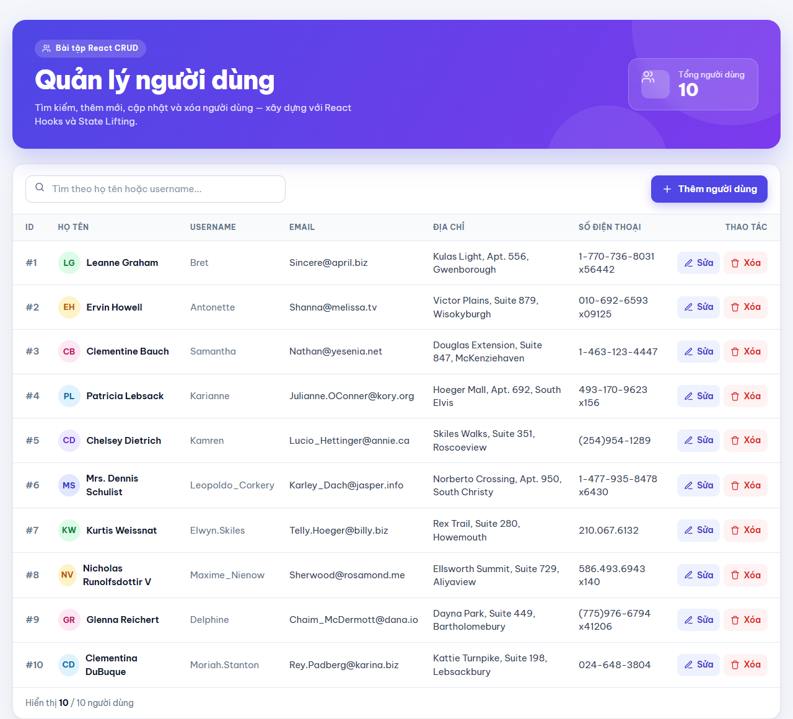
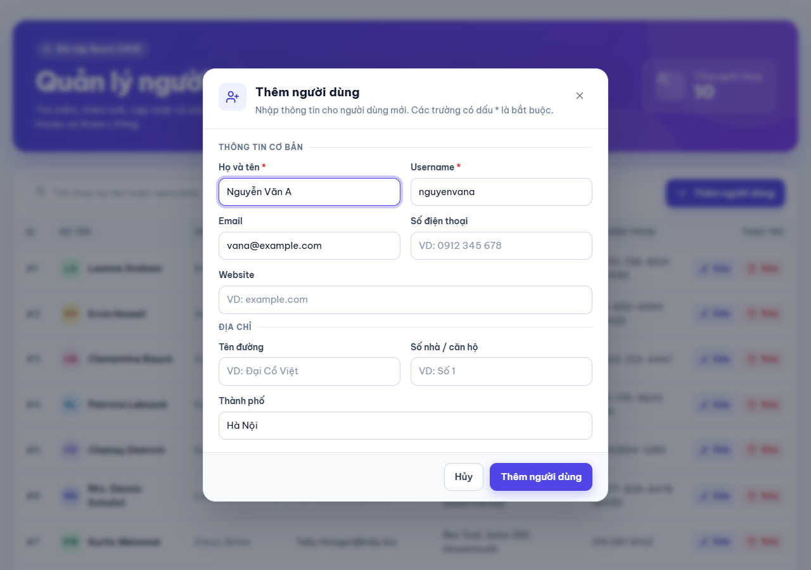
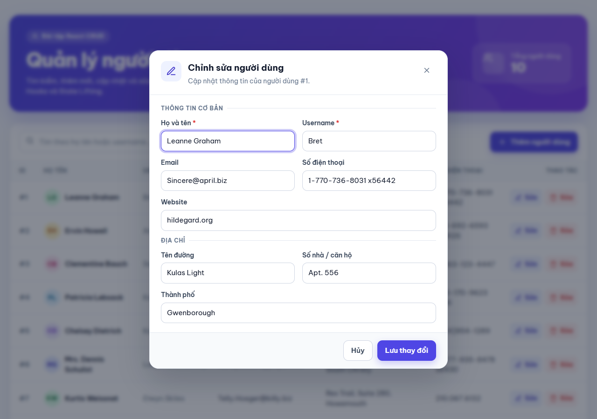
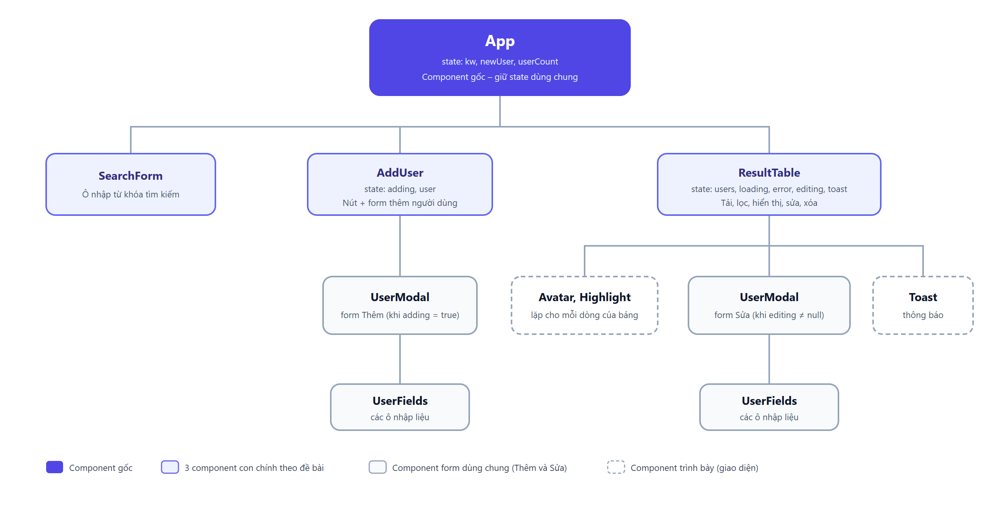
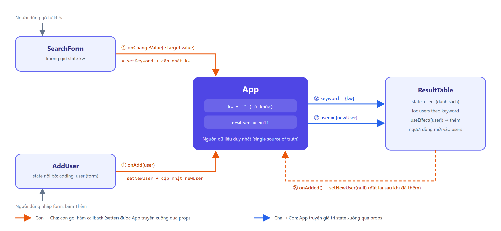

# Assignment 06 – Ứng dụng CRUD đơn giản với React

**Sinh viên:** Nguyễn Trần Gia Phụng – MSSV 20235402

| Nộp bài | Liên kết |
|---|---|
| Link báo cáo Ứng dụng React CRUD | https://github.com/nguyenphung25/CNWeb_NguyenPhung_20235402/tree/main/assignment06 |
| Link kết quả Ứng dụng React CRUD | https://nguyenphung25.github.io/CNWeb_NguyenPhung_20235402/assignment06/ |
| Báo cáo Word | [BaoCao_React_CRUD.docx](BaoCao_React_CRUD.docx) |

## 1. Kết quả

Ứng dụng quản lý người dùng viết bằng React 18 (CDN + Babel): tải danh sách từ JSONPlaceholder bằng `useEffect`, tìm kiếm theo name/username, thêm/sửa qua form modal và xóa người dùng.



| Form thêm | Form sửa |
|---|---|
|  |  |

## 2. Sơ đồ Component Tree



| Component | Vai trò |
|---|---|
| `App` | Component gốc, giữ state dùng chung `kw`, `newUser` và truyền props xuống con. |
| `SearchForm` | Ô nhập từ khóa tìm kiếm. |
| `AddUser` | Nút và form thêm người dùng (state cục bộ `adding`, `user`). |
| `ResultTable` | Tải, lọc, hiển thị danh sách; sửa và xóa người dùng. |
| `UserModal`, `UserFields` | Khung modal và các ô nhập dùng chung cho form Thêm và Sửa. |

## 3. Sơ đồ luồng dữ liệu (State Lifting)



- **Tìm kiếm:** `SearchForm` gọi `onChangeValue` (= `setKeyword`) → `App` cập nhật `kw` → truyền `keyword` cho `ResultTable` để lọc.
- **Thêm mới:** `AddUser` gọi `onAdd` (= `setNewUser`) → `App` cập nhật `newUser` → truyền `user` cho `ResultTable`; bảng thêm người dùng rồi gọi `onAdded()` để đặt lại `newUser = null`.

**Vì sao `kw` và `newUser` đặt ở `App`?**

1. React truyền dữ liệu một chiều từ cha xuống con; `SearchForm`, `AddUser`, `ResultTable` là các component ngang hàng nên không truyền trực tiếp cho nhau được.
2. `kw` sinh ra ở `SearchForm` nhưng được dùng ở `ResultTable`; `newUser` sinh ra ở `AddUser` nhưng phải được thêm vào danh sách trong `ResultTable`. Nếu đặt ở component con thì `ResultTable` không thể đọc được.
3. Vì vậy state được "nâng" lên cha chung gần nhất là `App`: con nhận hàm set để gửi dữ liệu lên, `ResultTable` nhận giá trị qua props. Dữ liệu chỉ có một nguồn nên luôn đồng bộ.

## 4. Bảng Props truyền từ App

| Component | Prop | Giá trị từ App | Kiểu | Mục đích |
|---|---|---|---|---|
| SearchForm | `onChangeValue` | `setKeyword` | Hàm | Cập nhật từ khóa `kw` |
| AddUser | `onAdd` | `setNewUser` | Hàm | Gửi người dùng mới lên App |
| ResultTable | `keyword` | `kw` | String | Lọc danh sách |
| ResultTable | `user` | `newUser` | Object \| null | Người dùng cần thêm |
| ResultTable | `onAdded` | `() => setNewUser(null)` | Hàm | Đặt lại `newUser` sau khi thêm |
| ResultTable | `onCountChange` | `setUserCount` | Hàm | Cập nhật ô tổng số người dùng |

## 5. Lỗi gặp trong quá trình code

### Lỗi 1: Bấm "Thêm" nhưng form không hiện

- **Hiện tượng:** bấm nút Thêm, form không xuất hiện; Console không báo lỗi. Code gây lỗi: `<button onClick={setAdding(false)}>Hủy</button>`
- **Nguyên nhân:** `onClick` cần nhận một hàm, nhưng `setAdding(false)` là lời gọi hàm nên chạy ngay khi render. Vừa bấm Thêm (`adding = true`), lúc render nút Hủy lại đặt `adding = false` nên form biến mất ngay.
- **Cách sửa:** truyền arrow function để chỉ gọi khi người dùng bấm: `<button onClick={() => setAdding(false)}>Hủy</button>`

### Lỗi 2: Warning trùng key khi thêm sau khi xóa

- **Hiện tượng:** xóa người dùng #2 rồi thêm mới, bảng có hai dòng cùng ID #10. Console báo:

  ```text
  Warning: Encountered two children with the same key, `10`. Keys should be
  unique so that components maintain their identity across updates.
      at tbody ... at ResultTable ... at App
  ```

- **Nguyên nhân:** ID mới tính bằng `prev.length + 1`. Sau khi xóa còn 9 người nên ID mới là 10, trùng với người #10 đang có; React dùng `key={u.id}` nên báo trùng key, và thao tác sửa/xóa theo ID ảnh hưởng cả hai dòng.
- **Cách sửa:** lấy ID lớn nhất hiện có cộng 1 (sau khi sửa, người mới nhận ID #11, hết warning):

  ```js
  const nextId = list.length ? Math.max(...list.map((u) => u.id)) + 1 : 1;
  ```
